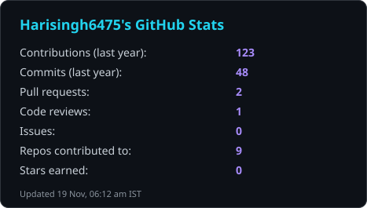
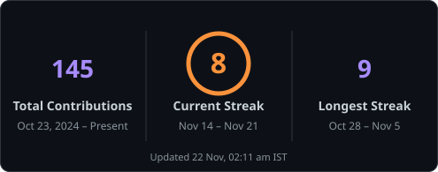
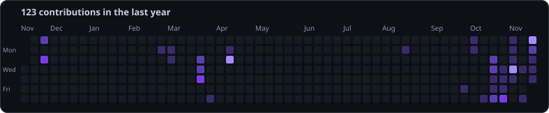

<h1 align="center">Hi, I'm Harisingh Rajpoot 👋</h1>

  <b>Full-Stack Developer</b> · B.Tech Computer Science @ Sitare University · AI/ML Enthusiast

  

  
  
  
  

---

## 🧑‍💻 About Me

- 🎓 B.Tech Computer Science student at **Sitare University, Lucknow** (graduating May 2027).
- 🏅 Recipient of a **100% full-tuition merit scholarship** from Sitare Foundation.
- 🛠️ I build full-stack web applications end to end: responsive frontends, REST APIs, relational databases, authentication and deployment.
- 🧠 Strong foundation in data structures, algorithms, object-oriented design and problem-solving.
- 🤖 Exploring AI/ML: search algorithms, classical machine learning and data analysis.

### 🔭 Currently working on

- **AlumVerse**: an alumni network and mentorship SaaS platform for colleges and schools.
- **Applicant Tracking System**: a multi-service team project built with Next.js, TypeScript and PostgreSQL.

---

## 🛠️ Tech Stack

**Languages**

  
  
  
  
  
  

**Backend & Frontend**

  
  
  
  
  
  

**Databases & DevOps**

  
  
  
  
  
  
  
  
  

**Data Science & ML**

  
  
  
  
  

---

## 🚀 Featured Projects

### 🌟 [AlumVerse: Alumni Network & Mentorship Platform](https://github.com/harisingh294/alumni-connect-platform)

A B2B SaaS platform that helps colleges and schools maintain a **verified alumni network**, track career outcomes, and connect students with alumni through **institution-approved, structured mentorship**.

- Role-based portals for **students, alumni, institution admins and platform admins**.
- Alumni roster onboarding through **CSV import** with column mapping, sanitisation and duplicate detection.
- Token-based authentication with salted **scrypt** password hashing.
- Multi-filter alumni search, subscription plans and an admin audit log.
- Automated end-to-end test suite built with `node:test`. Deployed on **Render** with **PostgreSQL (Neon)**.

`Node.js` `Express` `PostgreSQL` `SQLite` `JavaScript (ES Modules)` `Docker`

🔗 **[Live: alumverse.in](https://alumverse.in/)** · [Source code](https://github.com/harisingh294/alumni-connect-platform)

 

<table>
  <tr>
    <td width="50%" valign="top">
      <h3><a href="https://github.com/harisingh294/zara-interpreter">⚙️ ZARA Interpreter</a></h3>
      
A scripting language interpreter built from scratch in <b>pure Java</b>, with no external libraries. It uses a <b>Tokenizer → Parser → Evaluator</b> pipeline and supports variables, expressions, conditionals and loops. I worked on the parser and the user interface in this group project.

      
<code>Java</code> <code>OOP</code> <code>Recursive-Descent Parsing</code>

      
🔗 <a href="https://zarainterpreter.vercel.app/">Live Demo</a>

    </td>
    <td width="50%" valign="top">
      <h3><a href="https://github.com/harisingh294/myers-diff-algorithm">🔀 Myers' Diff Algorithm</a></h3>
      
A Python implementation of <b>Myers' O(ND) diff algorithm</b>. It compares two sequences, finds the shortest edit script, and uses backtracking to show which elements were kept, inserted and deleted.

      
<code>Python</code> <code>Algorithms</code> <code>Backtracking</code>

    </td>
  </tr>
  <tr>
    <td width="50%" valign="top">
      <h3><a href="https://github.com/harisingh294/SEIR_WebScraping_WordFrequency_Matching_Project">🕸️ Near-Duplicate Web Page Detection</a></h3>
      
Scrapes web pages, removes HTML and computes word frequencies. It builds a <b>64-bit SimHash</b> fingerprint for each page and uses <b>Hamming distance</b> to find similar or near-duplicate content without comparing full texts.

      
<code>Python</code> <code>Web Scraping</code> <code>SimHash</code>

    </td>
    <td width="50%" valign="top">
      <h3><a href="https://github.com/harisingh294/AI_Content">🤖 AI & Machine Learning Notebooks</a></h3>
      
Notebooks implementing core AI/ML algorithms: <b>A* maze pathfinding</b>, <b>Minimax with alpha-beta pruning</b>, <b>Logistic Regression</b>, and <b>Naive Bayes</b> text classification on the 20 Newsgroups dataset.

      
<code>Python</code> <code>NumPy</code> <code>scikit-learn</code> <code>Matplotlib</code>

    </td>
  </tr>
  <tr>
    <td width="50%" valign="top">
      <h3><a href="https://github.com/harisingh294/Final_LDU_Factorization-">🧮 LDU Factorization Tool</a></h3>
      
A browser-based linear algebra tool that splits a square matrix into <b>Lower-triangular, Diagonal and Upper-triangular</b> matrices. It checks whether the matrix can be decomposed and rebuilds the original matrix to confirm the result.

      
<code>JavaScript</code> <code>HTML</code> <code>CSS</code> <code>Linear Algebra</code>

    </td>
    <td width="50%" valign="top">
      <h3><a href="https://github.com/harisingh294/Crypto_Verses">🪙 CryptoVerse</a></h3>
      
A cryptocurrency-themed web application built as a group project, with a JavaScript frontend and Python components.

      
<code>HTML</code> <code>CSS</code> <code>JavaScript</code> <code>Python</code>

    </td>
  </tr>
</table>

---

## 👥 Team Experience

**Applicant Tracking System**: Capstone Project, Sitare University *(2026)*

- One of four team leads building a **multi-tenant applicant tracking system** with three Node.js services that share one PostgreSQL database.
- Implemented **open/closed job status management** for the Jobs API, with automated tests, during Milestone 2.
- Work follows code review on pull requests, module-boundary checks and Docker-based local environments.

`Next.js` `TypeScript` `Node.js` `PostgreSQL` `Docker`

---

## 📊 GitHub Activity

<table>
  <tr>
    <td align="center" width="50%">
      
    </td>
    <td align="center" width="50%">
      
    </td>
  </tr>
  <tr>
    <td align="center" colspan="2">
      
    </td>
  </tr>
</table>

Stats refresh automatically every 3 hours via GitHub Actions.

---

  <b>Learning by building, improving one project at a time.</b> 🚀 
  Feel free to reach out for collaborations or a chat about tech!

